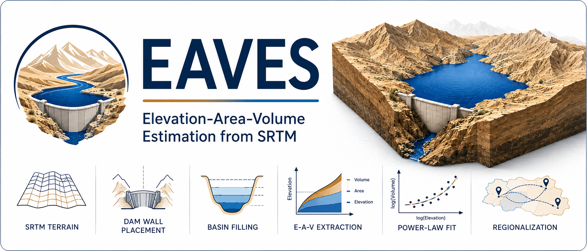

# 🏔️💧 **EAVES: Elevation-Area-Volume Estimation from SRTM**

_Reconstructing elevation-area-volume curves for ungauged dams in arid regions from SRTM topography acquired before most of them were built._

---

[](environment.yml)
[](https://doi.org/10.5281/zenodo.20731019)
[](https://github.com/hyex-research)

---

<p align="center">
  
</p>

## 🗺️ Overview

Reservoir bathymetry ties remotely sensed water extent to storage. In arid and hyper-arid **ungauged basins**, bathymetric surveys are costly in remote terrain and seldom made, so the elevation-area-volume (EAV) curves that convert water-surface area into storage volume are rarely available for small and medium dams and have to be inferred. **EAVES** reconstructs them from the **Shuttle Radar Topography Mission (SRTM)** digital elevation model. SRTM was acquired in February 2000, before most of the Saudi Arabian dams of the dataset were built, so the DEM preserves the valley topography beneath their reservoirs.

For each dam the pipeline:

1. **Places** a wall across the valley on the SRTM DEM in up to six automated stages, starting at the catalog coordinate
2. **Flood-fills** the valley behind the wall up to the spillway elevation, or to the level at which volume reaches catalog capacity, to reconstruct the reservoir footprint
3. **Integrates** the wetted area over elevation at 0.5 m levels into a tabulated EAV curve
4. **Fits** a power-law model V = c · A<sup>b</sup> to parameterize the area-volume relationship
5. **Regionalizes** the parameters so that dams without a reliable SRTM-derived fit receive regionally calibrated curves anchored to design capacity

The curves of the Saudi Arabian dams ship with the repository and need no run. [`eaves_params.csv`](region/ksa/output/1_results_csv/eaves_params.csv) gives the coefficients c and b of all 526 dams, which turn a satellite-observed water area A in m² into the storage V = c · A<sup>b</sup> in m³, and [`DATA_DICTIONARY.md`](region/ksa/output/1_results_csv/DATA_DICTIONARY.md) defines every column of the released tables with its unit. The dataset is archived on Zenodo ([doi:10.5281/zenodo.20728128](https://doi.org/10.5281/zenodo.20728128)).

> **Demonstration application.** EAVES was developed and validated on the arid and hyper-arid dams of **Saudi Arabia** (526 dams, 320 with an SRTM-derived curve and 206 regionalized). The method transfers to other regions with a DEM that predates most of their dams, a river network and a dam catalog with locations, design attributes and construction years, but its application to a new region is not automatic. The pipeline re-fits the regional parameters on the reliable curves of local dams built after the DEM acquisition, whereas the placement and acceptance constants and the quality thresholds, set on SRTM and the Saudi catalog, need re-evaluation for the new region.

## 🚀 Quickstart

```bash
conda env create -f environment.yml
conda activate eaves
pip install -e . --no-deps
./run_all.sh region/ksa/ksa.json
```

This runs the full chain: the placement-and-fit pipeline, validation, uncertainty propagation, panel figures and the Markdown report. The `/path/to/...` entries of the settings must first be set to your copies of the external data, and the regression test `pytest -m slow` runs from a clone alone. See [documentation/usage.md](documentation/usage.md) for installation, the flags, the diagnostics on request, the tests and the settings.

## 📚 Documentation

| Document | Contents |
| --- | --- |
| [documentation/method.md](documentation/method.md) | Domain preprocessing, wall placement, EAV curve construction and geometric interpretation, trusted and training sets, regionalization, limitations |
| [documentation/structure.md](documentation/structure.md) | Repository layout and region pattern |
| [documentation/usage.md](documentation/usage.md) | Installation, run commands, configuration |
| [documentation/outputs.md](documentation/outputs.md) | Files a run writes, from the released tables to the panels, check maps and report |
| [documentation/data-dependencies.md](documentation/data-dependencies.md) | Included data, licensing, external datasets |
| [DATA_DICTIONARY.md](region/ksa/output/1_results_csv/DATA_DICTIONARY.md) | Columns, units and controlled vocabularies of the released tables |
| [AGENTS.md](AGENTS.md) | Operational brief for AI coding agents (setup, verification, conventions, guardrails) |
| [CHANGELOG.md](CHANGELOG.md) | Versioned change log |

## 🤖 Agent-ready

EAVES ships with first-class support for AI coding agents and assistants:

- **[AGENTS.md](AGENTS.md)**: the operational brief (layout, run commands, verification, conventions, guardrails)
- **Machine-readable outputs**: the domain characterization has a JSON twin with typed values
- **`eaves info`**: the resolved configuration and output layout as JSON, running nothing
- **MCP server**: `eaves mcp` serves read-only tools over the [Model Context Protocol](https://modelcontextprotocol.io) (`pip install -e ".[mcp]"` from the repository root), so AI assistants can query configurations and results directly while execution stays with the CLI

## 📄 Related manuscript

This repository accompanies the manuscript:

> **"Elevation-area-volume curves for 526 Saudi Arabian reservoirs from SRTM topography and regionalization"**
>
> Ivanović, N., et al.

If you use this repository in academic work, please cite the manuscript and this repository ([CITATION.cff](CITATION.cff)).

## 📜 License

The **source code** is licensed under the [Apache License 2.0](https://www.apache.org/licenses/LICENSE-2.0) (`LICENSE`).

The **data products generated by this project** are licensed under [Creative Commons Attribution 4.0 International (CC BY 4.0)](https://creativecommons.org/licenses/by/4.0/) (`LICENSE-DATA`).

[](https://www.apache.org/licenses/LICENSE-2.0)
[](https://creativecommons.org/licenses/by/4.0/)
