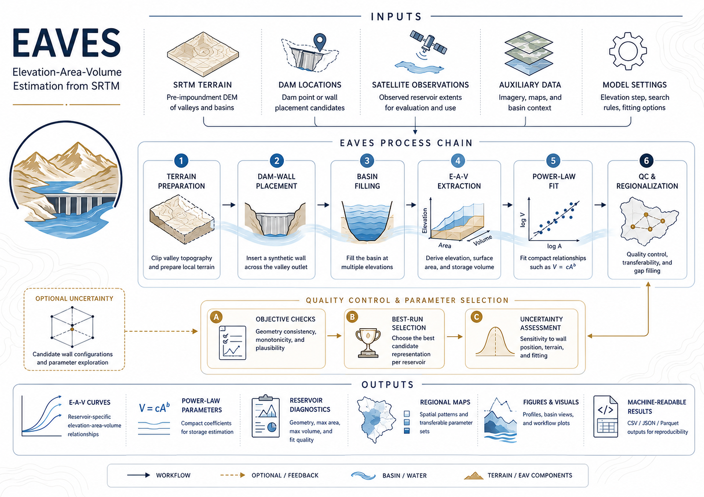
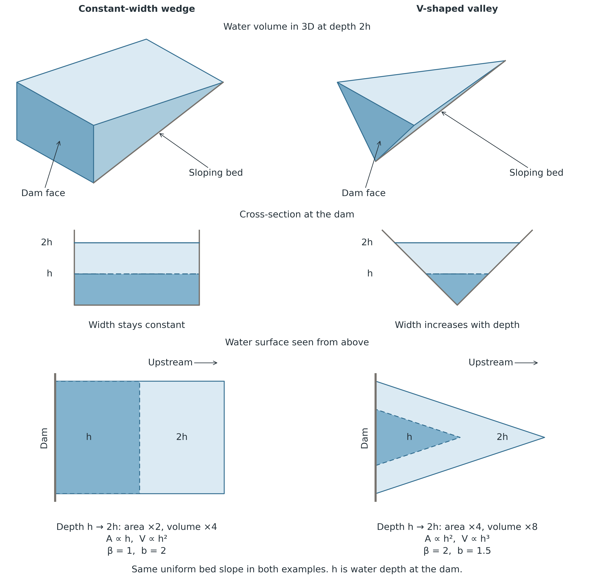

# Method

How EAVES reconstructs elevation-area-volume (EAV) curves from SRTM topography, from the preprocessing of the river network to the regionalization, and where the reconstruction reaches its limits. For run commands see [usage.md](usage.md). For the files a run writes see [outputs.md](outputs.md). The accompanying manuscript gives the full treatment, including validation and uncertainty.

## Domain preprocessing

Preprocessing drops zero-length MERIT-Basins reaches, keeps every reach that touches the country together with every reach that drains into it, and retains the part of that network within 0.3° of a dam. A reach longer than `max_seg_len_m` is cut into equal parts along the channel, and each part carries an equal share of the reach length and unit-catchment area. A dam within `max_snap_distance_m` of a part, measured on the ground in its UTM zone, is attached to the nearer endpoint of the nearest part. The river direction at the wall comes from a chord extending 500 m along the channel on either side of the point of that part nearest the dam, cut at the part ends.

## Dam wall placement

The algorithm searches for a dam wall across the valley, starting at the cataloged coordinate and, if processing is unsuccessful, again from the snapped river node. Candidate walls are scored by the mismatch between valley width and catalog dam length and by their alignment across the river and the SRTM-derived downslope direction. A dam without a river part within the snap radius is placed on the SRTM slope alone and skips stage 4. Six placement stages are attempted in sequence:

| Stage | Strategy | Description |
| --- | --- | --- |
| 1 | **Direct placement** | Place a terrain-aligned wall at the starting point |
| 2 | **Upstream walk** | Walk upstream along the valley thalweg and retry at each position |
| 3 | **Quality recovery** | Repeat the upstream search when the accepted footprint is skewed downstream, displaced, or short of catalog capacity |
| 4 | **River-direction retry** | Move the wall along the snapped river, upstream and downstream, and keep a candidate only when its volume lies closer to the catalog capacity than the fill it replaces |
| 5 | **Relaxed alignment** | Allow wall orientations that would normally be rejected by the flow-alignment filter |
| 6 | **Fallback** | Place a synthetic wall at the starting point, trying several wall directions, when no earlier stage yields an acceptable footprint |

Every stage accepts a fill only when it drains out through the wall. The DEM window is flooded from its edge inward in order of elevation, which gives each cell the cell it drains to, and at least half of the pool held at catalog capacity must drain out within half the wall length plus 1 km of the dam cell. The outlets of that pool, weighted by the share of the pool each drains, must also lie on average in the dam-side 65% of its length. This second test decides for a pool shorter than that distance, whose outlets all lie within it. A fill on the downstream side of the wall drains out at its far end and is rejected, whichever way the local slope at the dam points. A pool on open ground can pass this test where it drains out along its whole rim, so every stage also rejects a pool that the river reach and the terrain slope both place downstream of the dam. More than 90% of such a pool lies down the river reach from the dam cell and more than half of it down the terrain slope. A gap of the DEM that terrain encloses takes the highest elevation of its rim before the placement, so it floods only at a level that floods every cell around it, and the dam fails when such cells make up 5% or more of the accepted footprint.

## EAV curve construction

Once the footprint is established, the area is counted at elevation levels 0.5 m apart from the floor of the fill, with the spillway elevation itself as the last level, and cumulative trapezoidal integration yields volume. The fill is capped at the catalog capacity. When the volume at the spillway exceeds the capacity, the last level moves to the elevation where the integrated volume equals the capacity, found by bisection inside the step that crosses it, with the area inside that step running linearly between the bounding levels as the trapezoid rule assumes, so every capped fill ends exactly at its catalog capacity. A regular level within a centimeter of the spillway or of the capped level gives way to it, so no two rows of a table share an elevation. For dams built before 2000 and the one dam without a recorded construction year, a flat-water screen looks for a connected pool of at least 50 cells with an elevation standard deviation of 1 m or less in the footprint. Where it finds one, the curve is a partial curve fitted from the mean pool elevation upward (`curve_type = partial` and `srtm_water_level_m` in `eaves_summary.csv`). It includes the recorded water-surface area but does not recover the storage beneath it. A two-parameter power law (V = c · Ab) is fitted by nonlinear least squares to the untransformed area-volume pairs. For trusted dams the released exponent is bounded below at 1, which requires the modeled mean depth (V/A) to stay constant or increase with surface area. Where the fitted exponent falls below the bound, b is set to 1 and c is recalculated to preserve the recovered full-pool area and volume. The summary keeps the unconstrained least-squares fit.

### Geometric interpretation of the exponent

The exponent b in V = c · Ab describes how reservoir volume V increases with water-surface area A. The two idealized geometries below illustrate its meaning. Both have a bed that rises uniformly upstream from the dam.

Water depth at the dam is denoted by h. The top row shows the water volume at depth 2h. In the middle and bottom rows, dark blue shows the extent at h, and pale blue shows the additional extent at 2h.

**Constant-width wedge.** Vertical sides keep the width constant as the water rises. The pool becomes longer and deeper. Doubling depth therefore doubles surface area and quadruples volume. Area is proportional to h and volume to h², giving V ∝ A² and b = 2.

**V-shaped valley.** Straight, sloping sides allow the pool to widen as it deepens and lengthens. Doubling depth doubles both width and length, so surface area increases fourfold and volume eightfold. Area is proportional to h² and volume to h³, giving V ∝ A1.5 and b = 1.5.

The area-depth exponent β describes the relation A ∝ hβ. Integrating area over depth gives b = 1 + 1/β for β > 0. Thus, β = 1 for the wedge and β = 2 for the V-shaped valley.

## Trusted set and training set

Fits passing the reliability gates (quality grades A-B, R² ≥ 0.98, 0.3 ≤ V_SRTM/V_cap ≤ 5.0, n_pixels ≥ 50, b defined) form the **trusted set**. Of these, only dams built in or after 2000 (verifiably postdating the February 2000 SRTM acquisition) form the **training set** that the regionalization, the exponent spread b_σ, and the leave-one-out validation are computed on. Pre-2000 and unknown-year dams ship their own SRTM curves (flagged `pre_srtm` / `unknown_year`) but do not train the recipe, because their valley floors may already carry sediment. On the Saudi domain the trusted set holds 320 dams and the training set 221.

## Regionalization

Dams without a trusted SRTM-derived fit, including those whose wall placement, fill acceptance or power-law fit fails, receive parameters from a two-component, regionally calibrated empirical procedure, which pairs a regional exponent b with a predicted full-pool area that fixes c:

- **Exponent b**: the median exponent of the training dams at or above the capacity threshold with complete morphometric features. The better of a linear regression and a random forest on four morphometric features (`valley_ratio`, `channel_slope`, `mean_catchment_slope`, `dam_height_m`) replaces the median only if its leave-one-out R² reaches 0.25, a threshold neither model reaches on the Saudi domain.
- **Coefficient c**: back-solved as c = V_cap/A_capb from catalog capacity and a multi-feature linear regression that predicts log A_cap from seven log-space features: `capacity_mcm`, `dam_height_m`, `spillway_height_m`, `valley_ratio`, `channel_slope`, `mean_catchment_slope`, `upstream_area_km2`. Any feature missing for a given dam is imputed with the training-set median so the regression always returns a finite value.

Leave-one-out evaluation on the training set assesses how well the procedure reconstructs the SRTM-derived curves, not accuracy against measured storage. On the Saudi domain 88% of the full-pool predictions lie within a factor of two and 99.5% within a factor of three of the SRTM-derived reference, with a median bias of +18% and a relative RMSE of 53%. At half and a tenth of the full-pool area, 91% and 76% lie within a factor of two. Full-pool agreement, however, is partly anchored by construction, because the predictions and most reference fills use catalog capacity. `eaves.postprocess.validation` compares the selected procedure with anchors based on satellite water extent or catalog capacity alone in `validation/regionalization_loo.csv`, and panel `p4` shows the leave-one-out evaluation at the three pool levels.

## Post-placement QC

After the capacity cap, automated quality gates reject a fill whose centroid is displaced from the dam and, for dams of 1 MCM or more, a fill whose volume stays below 20% of catalog capacity. The rejected dams are listed as `bad_fill_auto` in `failed_dams.csv` and receive regionalized parameters.

## Limitations

EAVES reconstructs reservoir geometry from the SRTM surface, not a surveyed bathymetric record. The curves describe the valley geometry beneath the reservoir, not its present capacity.

- **Valley-geometry approximation, not bathymetry**: curves follow the SRTM valley surface up to the spillway, not a measured reservoir bottom. They are sensitive to DEM noise (vertical LE90 ~6 m, [Rodríguez et al. (2006)](https://doi.org/10.14358/PERS.72.3.249)) in the same way the underlying terrain is.
- **Automated wall placement**: the wall orientation and length come from a terrain-alignment search at or near the catalog coordinates. It is the best-fit crest for that SRTM patch, not necessarily the engineered structure, and small placement shifts can meaningfully change the reconstructed footprint.
- **SRTM snapshot (February 2000)**: for dams built in 2000 or later, the SRTM surface is the pre-impoundment terrain. For dams built before 2000, it represents conditions in 2000, potentially including impounded water or sediment. The SRTM-derived curves of these dams therefore describe the valley as it stood in 2000, whereas the dams among them without a trusted fit carry regionalized curves anchored to the design capacity. Dams built before 2000 are flagged `pre_srtm`, dams without a recorded build year `unknown_year`, and both are excluded from regionalization training.
- **Resolution-limited regimes**: small footprints (`n_pixels < 30`), narrow valleys (`valley_width_m < 3 × pixel_size`), and low spillway heights (`spillway_height_m < 5 m`) produce curves with elevated uncertainty. See the `uncertainty_flags` column in `eaves_summary.csv` for per-dam tagging.
