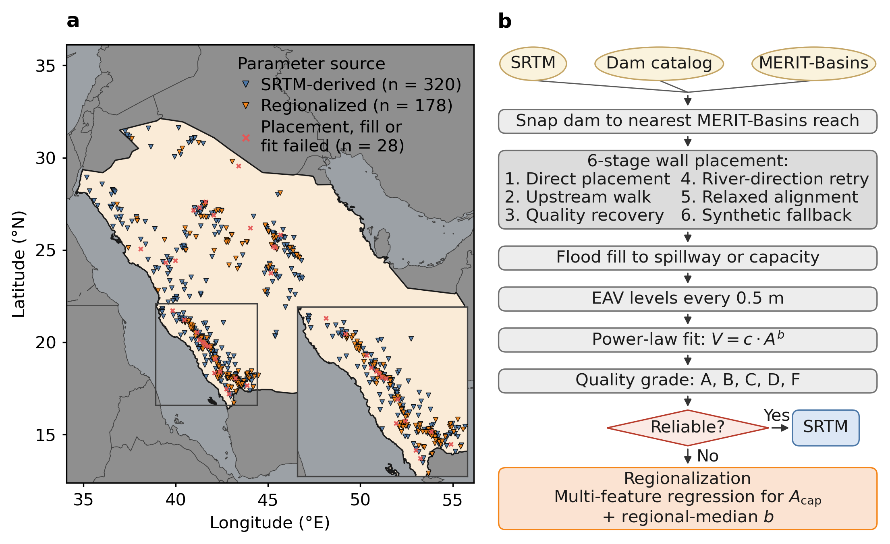
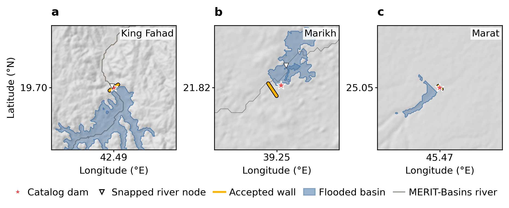
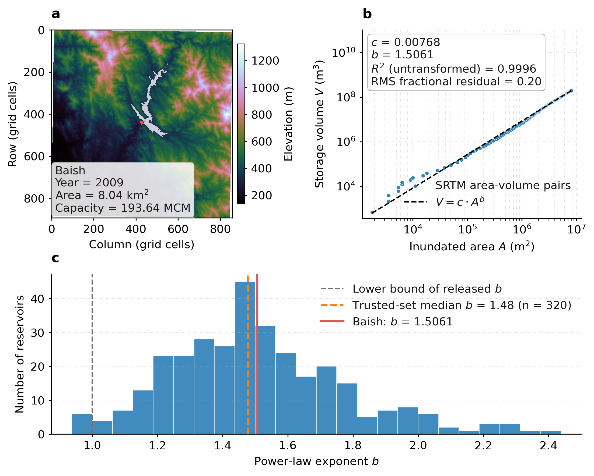
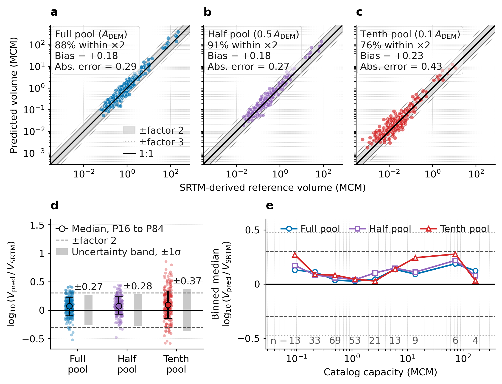
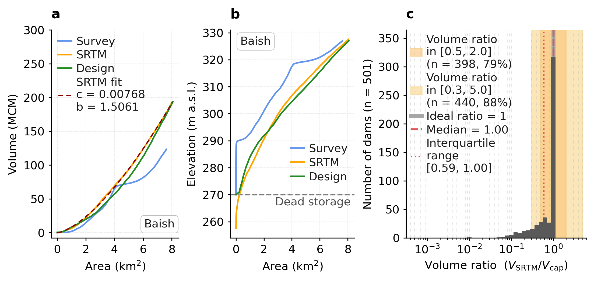
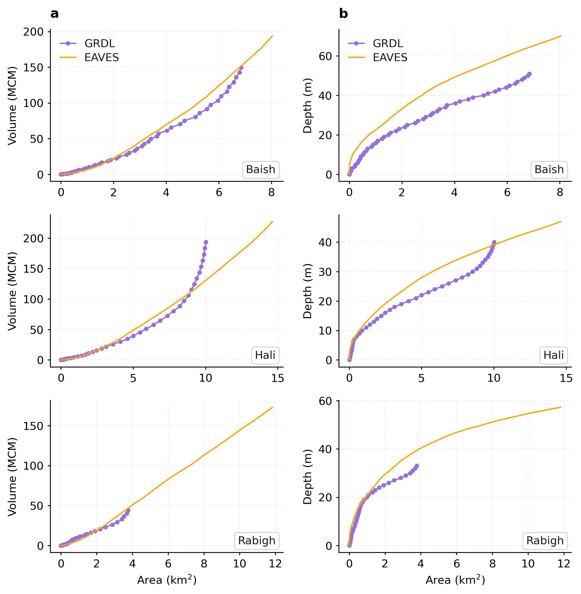
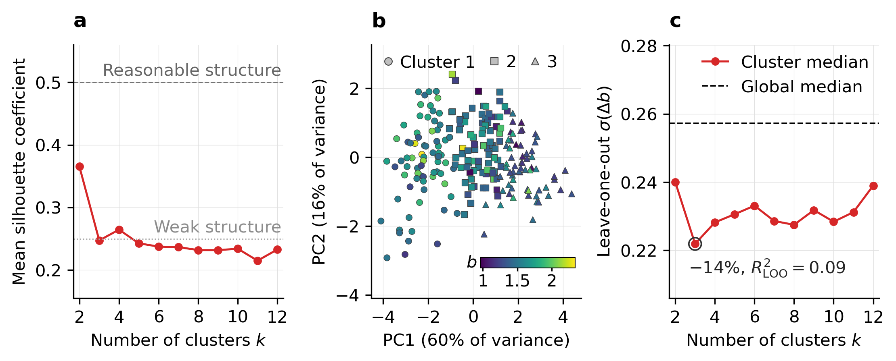
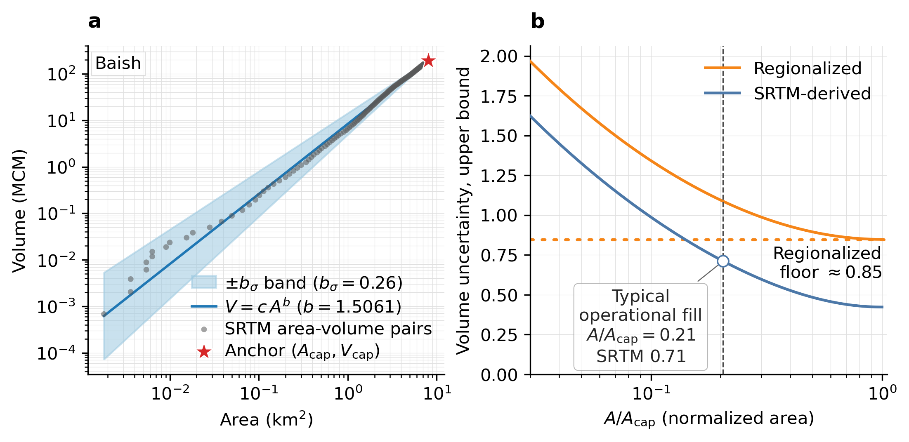

# EAVES domain report: Saudi Arabia

Generated: 2026-11-05 08:54 UTC

Source code: `eaves/` package. This report: `eaves.postprocess.report`.

This document characterizes the reservoir population in the configured region and explains the EAVES pipeline that produced its elevation-area-volume (EAV) curves. It covers the physics of the power-law parameterization, the DEM-based fitting procedure used for trusted dams, the regionalization procedure used for the remainder, and the leave-one-out evaluation behind the accuracy figures reported in the panel set. Every number quoted below is regenerated from the pipeline outputs at runtime, so figures and prose move together as the catalog or methodology evolves.

## Executive summary

- **Catalog**: 526 dams with assigned EAV parameters.
- **SRTM-derived curves**: 320 dams have curves fitted directly to their SRTM flood fills (the trusted set).
- **Regionalized curves**: 206 dams without a trusted SRTM-derived fit receive parameters from a two-component, regionally calibrated empirical procedure. Of these, 28 are dams whose wall placement, fill acceptance or power-law fit fails, regionalized with the topographic features recorded when processing stopped.
- **Operational fill behavior**: across the 282 trusted dams with a nonzero 95th-percentile satellite-observed water extent, that extent reaches a median 20.5% of the DEM-derived full-pool footprint. This is the central fact behind the choice of the regionalization anchor below.
- **Sediment budget**: assuming delivered sediment yields (the RUSLE-by-SDR product of [Dash et al. 2025](https://doi.org/10.1016/j.jenvman.2025.127199), so no additional delivery ratio is applied) and a deposited bulk density of 1.30 t m⁻³, the median predicted capacity loss by 2026 is **42.4%** of the catalog value (loss capped at 100% by trap saturation, and 152 reservoirs reach full siltation).
- **Regionalization accuracy (leave-one-out on the training dams, multi-feature regression)**: 88% of predicted volumes lie within a factor of two of the SRTM-derived reference at full pool, 91% at half pool and 76% at tenth pool, with a median bias of +18% at full pool.

## Pipeline overview

EAVES uses a dam catalog (coordinates, design capacity, dam length and height, spillway height, construction year), SRTM GL1 elevation tiles, the MERIT-Basins river reaches and unit catchments, a country boundary for selecting the reaches and, optionally, a satellite water-extent series per dam and a catchment table with upstream areas and sediment yields. For each dam it executes the following stages, all coded in the `eaves` package:

1. **Preprocessing** (`eaves.preprocess`): the MERIT-Basins reaches of the country and of every reach that drains into it are clipped to a per-dam bounding box, reaches longer than 2 km are subdivided into equal parts, and each dam takes the nearer endpoint of the nearest reach part within 1 km of its catalog coordinate as its snapped node.
2. **DEM clip and reprojection** (`eaves.pipeline.terrain`): the SRTM tile mosaic is clipped to a per-dam radius and reprojected to the appropriate UTM zone.
3. **Dam wall placement and flood fill** (`eaves.pipeline.placement`, `eaves.pipeline.curves`): a six-stage procedure places a terrain-aligned wall at the starting point (stage 1), walks upstream along the valley and retries (stage 2), repeats the upstream search when the accepted footprint is skewed downstream, displaced or short of catalog capacity (stage 3), shifts the wall upstream and downstream along the river for a closer match to catalog capacity (stage 4), retries with relaxed flow alignment (stage 5) and finally places a synthetic wall at the starting point (stage 6). The acceptance checks screen each fill for basin-floor elevation, vertical extent, downstream leakage and pool position, drainage near the wall, displacement from the dam, SRTM voids and volume.
4. **Power-law fit** (`eaves.pipeline.curves`): the area-volume pairs from the lowest represented elevation to the spillway, or for capped fills to the level where the volume reaches catalog capacity, are fitted to V = c Ab on untransformed volumes by nonlinear least squares, returning (c, b, R²). For trusted dams the released exponent has a lower bound of 1, with c re-solved to keep the full-pool area and volume.
5. **Quality grading and reliability tagging** (`eaves.postprocess.regionalization`): each fit gets a grade A to F. The trusted subset holds the fits with grade A or B, R² ≥ 0.98 and an active footprint of at least 50 grid cells, which is stricter than grades A and B alone. The capacity floor of the training dams that set the regional b is chosen by a sweep of `frac_reliable` against candidate cutoffs (see Fig. S4).
6. **Regionalization** (`eaves.postprocess.regionalization`): dams outside the trusted subset receive (c, b) from the two-component, regionally calibrated empirical procedure described below.
7. **Leave-one-out evaluation** (`eaves.postprocess.validation`): leaving out each training dam (trusted and built after 2000) in turn gives the accuracy distribution of each regionalization anchor.

Outputs land under `<OUTPUT_DIR>/1_results_csv/` and `<OUTPUT_DIR>/2_results_plots/`.

_Figure 1. (a) Locations of the retained dams, marked by curve source (SRTM-derived or regionalized), with the dams whose wall placement, fill acceptance or power-law fit fails marked separately. The inset enlarges an outlined area in the southwest of the country. (b) The pipeline combines SRTM topography, the MERIT-Basins river network and the dam catalog and runs from wall placement and flood fill to the fitted power law and the per-dam EAV table._

## Physics of the area-volume relation

Reservoir storage is integrated from a hypsometric area-elevation function: V(z) = ∫z_minz A(ζ) dζ. For a valley filled by a transverse dam, the wetted area at elevation z is set by where the water surface intersects the surrounding terrain. If the wetted area grows with depth as A(z) ∝ (z − z_min)β, with z_min the basin-floor elevation and β > 0, integrating area over depth gives V = c Ab with b = 1 + 1/β.

Two idealized valley shapes with uniformly sloping beds illustrate the relation. In a constant-width valley the pool lengthens without widening as water rises, so this wedge-shaped pool has an area proportional to depth (β = 1, b = 2). In a V-shaped valley with straight side slopes, however, the pool widens and lengthens in proportion to depth, so its area grows with depth squared (β = 2, b = 1.5). The assumed area-depth relation permits any b > 1, including b > 2 when 0 < β < 1. An exponent below 1 would make the mean depth V/A fall as the area grows.

In this region's trusted set (n = 320), the unconstrained exponent b has median **1.48**, a P05 to P95 range of [1.10, 2.00] and a full range of [0.97, 2.43]. The spread that enters the uncertainty bands is taken over the training dams, b_σ = 0.26.

The coefficient c sets the absolute scale of the curve. Once b is fixed, anchoring at a known point (A_cap, V_cap) pins c = V_cap / A_capb. This back-solve is exact at the anchor, so any uncertainty in b shows up as V_pred / V_ref = (A/A_cap)Δb at other water levels. A mismatch in b equal to the trusted-set spread (0.26, the P16 to P84 half-width) therefore produces about 19% volume error at 0.5 A_cap and about 80% at 0.1 A_cap, without the area-independent terms of the band. For applications that need detail at low water levels, the released EAV tables in `eav_tables/` retain the SRTM-derived hypsometry within the reconstructed range, which the power law smooths over.

## Domain characterization

### Catalog demographics

The placement pipeline produces a flood fill for n = 501 dams. Together with the 25 dams without a fill, which carry enough catalog metadata to be regionalized, **526 dams** in total receive an EAV curve assignment (320 SRTM-derived, 206 regionalized). Aggregate design storage is **2,478 MCM**. The capacity distribution is strongly right-skewed: median 0.47 MCM, P05 to P95 = [0.07, 10.0] MCM, maximum 325.0 MCM. By size class:

| Class | Count |
| --- | --- |
| V_cap ≥ 100 MCM | 5 |
| V_cap ≥ 25 MCM | 15 |
| V_cap ≥ 5 MCM | 43 |
| V_cap < 1 MCM | 368 |

Construction years span 1950 to 2025 with the median dam built in 2008. Era breakdown:

| Era | Count |
| --- | --- |
| Before 1980 | 41 |
| 1980 to 1999 | 150 |
| 2000 to 2009 | 144 |
| 2010 or later | 190 |
| Year unknown | 1 |

The one dam without a recorded construction year is retained in every EAV product and carries the `unknown_year` flag. It is screened for flat water like the dams built before 2000, and it is left out of the regionalization training set, the era classes above and the sediment budget below.

### Operational fill behavior

For the 282 trusted dams with a nonzero 95th-percentile satellite-observed water extent, that extent (A_satP95) is compared with the SRTM-derived full-pool area A_DEM. The ratio A_satP95 / A_DEM characterizes how fully a reservoir is operated relative to its design.

In this region the median ratio is **0.21**, so the 95th-percentile extent of a typical reservoir reaches only about 20.5% of its full-pool area. The P16 to P84 band is [0.03, 0.54]. Only 53 of the 282 dams (18.8%) reach half the full-pool area at that extent.

This shortfall reflects sparse, episodic inflows in an arid climate, operational drawdown, seepage and evaporation losses, and the design margin built into nominal capacities, consistent with human-managed reservoirs commonly operating well below design capacity ([Cooley et al. 2021](https://doi.org/10.1038/s41586-021-03262-3)). At Baish, the SRTM-derived area at the end of the fill matches the design spillway area (Figure 5b).

The same shortfall motivates the choice of the regionalization anchor in this report. An anchor at the 95th-percentile satellite-observed water area does not match the full-pool area that catalog capacity refers to, so anchoring V_cap at A_satP95 increases c by (A_DEM/A_sat)b, about 10.9× at the median in this region. Anchoring against a DEM-derived A_cap instead keeps both endpoints in the design regime.

### Sediment budget

A first-order sediment budget is computed from catchment-specific delivered-yield estimates (`sed_yield_t_ha_yr`) and upstream catchment areas, propagated to the reference year (2026) with a uniform deposited bulk density ρ_sed = 1.30 t m⁻³ ([Morris and Fan 1998](https://www.reservoirsedimentation.com/)). The yield input is _delivered_ sediment yield at the reservoir inlet. [Dash et al. (2025)](https://doi.org/10.1016/j.jenvman.2025.127199) compute it as RUSLE gross erosion times an area-dependent delivery ratio (their Eqs. 2 to 4), so no additional delivery ratio is applied here (a second SDR would double-discount delivery). The budget holds each catchment's yield constant from the construction year to the reference year, charges each dam with the yield of its whole upstream catchment without trapping by dams further upstream, and assumes complete trapping in the reservoir and no removal by flushing or dredging. The accumulated trap volume is V_sed = Y · A_cat · (t - t_built) / ρ_sed, and the predicted fractional capacity loss is capped at 100% by trap saturation (a reservoir cannot lose more storage than it holds).

Across n = 525 dams with all required inputs, the predicted median capacity loss is **42.4%** of design capacity, with P16 to P84 = [10.5%, 100.0%]. Of the 525 dams, 241 are predicted to have lost more than half of their design capacity and 152 to be effectively silted, with a deposited volume that reaches or exceeds design capacity before the loss is capped. The per-dam capped fraction and a categorical risk band are released as `predicted_silt_fraction` and `sediment_risk` in `eaves_summary.csv`.

At Baish (id_120000), the reservoir with a sonar survey, the budget predicts a loss of 24% of design capacity by the reference year and 23% at the survey date, against the 36% loss that the survey of Figure 5 records at the top of the design table, so the surveyed loss is 1.6 times the budget at that date.
The per-dam numbers are first-order screening indicators, not site predictions. A region-specific calibration would benefit from comparative bathymetry on a small panel of reservoirs spanning the size range.

The EAV curves describe the terrain as SRTM imaged it in February 2000. For dams built after the acquisition this is the valley before impoundment, so their curves give design storage rather than present-day storage. For the `pre_srtm` dams with an SRTM-derived curve it is the valley as it stood in 2000, which may already hold sediment deposited since construction. The regionalized curves are anchored to the catalog design capacity. A sediment-corrected operational curve set can be produced by subtracting V_sed from the V axis of the released curves (with the curve truncated below the predicted sediment floor) but is not the canonical product. For `pre_srtm` dams, however, the budget integrates deposition from the construction year, so subtracting V_sed from their SRTM-derived curves counts the deposit already present in 2000 twice.

### Geometry distribution and regionalization features

On the trusted subset (n = 320), the unconstrained exponent b has median **1.48**, which compares with b = 1.5 for an idealized V-shaped valley. These empirical fits, however, emphasize the upper storage levels and need not represent the geometry throughout the basin.

The empirical area-capacity relation, fit on the training dams as log₁₀ A_cap [km²] = α + β_A log₁₀ V_cap [MCM], yields α = -0.58 and β_A = 0.71 with a residual RMS of a factor of 1.65 over n = 221 training dams. The fitted β_A is close to the geometric expectation of 2/3 for cone-like valley fills. The validation uses this relation as the capacity-only comparison anchor.

## SRTM-derived curves

For each dam that survives placement and quality gating, the curve is fit directly from the SRTM-clipped flood fill. Levels 0.5 m apart run from the lowest represented elevation to the spillway or, for capped fills, to the level where the integrated volume reaches catalog capacity. At each level z the wetted area A(z) is the number of footprint cells at or below z times the cell area, and at the final capped level the area is interpolated linearly between the adjacent levels. The volume V(z) = ∫ A dz follows by cumulative trapezoidal integration, and the resulting (A, V) pairs are fit to V = c Ab. The procedure is purely geometric and uses no satellite or in-situ data. Curves that pass the trusted-set filter (grade A or B, R² ≥ 0.98 and an active footprint of at least 50 grid cells) are the reference against which all other claims in this report are calibrated.

The 498 converged power-law fits have a median R² of 0.9961. Fitting untransformed volumes emphasizes the upper reservoir levels, so a high R² can mask larger relative errors at low storage. The absolute fractional volume residual |c Ab − V| / V at each fitted level, released per dam in `validation/goodness_of_fit.csv`, counts every level equally and is therefore sensitive to large relative differences at low volumes. Among the 320 trusted dams its per-dam root-mean-square has a median of 0.31, with 10th to 90th percentiles of [0.16, 0.61]. Compared with the SRTM-derived volumes, the median absolute difference is 2% at full pool. Median absolute differences, calculated within each dam and then across dams, are 2% over the upper half of the full-pool area and 40% below a tenth. At 21% of the full-pool area, the median satellite 95th-percentile water extent, the median absolute difference is 11%.

A two-segment straight-line fit in log space, with the break chosen per dam by the log-space sum of squares, is the alternative to the single power law. It reduces the median root-mean-square fractional residual across the trusted dams from 0.31 to 0.12. At storage levels of at least 10% of the maximum SRTM-derived volume, however, the median is 0.06 for the power law and 0.06 for the two-segment fit, so the gain lies at the low stages that the tabulated EAV curves of `eav_tables/` describe directly.

Two comparisons with reference datasets check the consistency of the EAVES curves rather than validating them directly. (i) The sonar survey of Baish gives a spillway-level capacity well below the design capacity, consistent with storage lost to sedimentation since construction. The survey describes the present reservoir, whereas the SRTM-derived curve represents the valley before the dam was built. The design table agrees with the SRTM-derived curve within a few percent in area and volume at the design spillway level (Figure 5). (ii) Three GRDL curves, which a deep-learning model reconstructs from the surrounding SRTM terrain with reservoir boundaries set mainly by Landsat-observed water extents ([Hao et al. 2024](https://doi.org/10.1029/2023WR035781)), differ from the EAVES curves in volume at equal area by a mean absolute 22% (Baish), 25% (Hali) and 38% (Rabigh) over the area range that GRDL represents (Figure 6). These comparisons assess consistency rather than volumetric accuracy.

_Figure 2. Examples of the six-stage dam-wall placement procedure. (a) Direct placement at the catalog coordinate (stage 1). (b) Wall shifted along the river to improve the volume match to catalog capacity (stage 4). (c) Synthetic wall at the catalog coordinate after unsuccessful terrain-based placement (stage 6). Red stars mark the catalog dam locations, white triangles the snapped MERIT-Basins nodes and amber lines the accepted walls. Blue polygons show the 8-connected flooded basins over hill-shaded SRTM terrain, each filled to the spillway elevation or to catalog capacity, whichever it reaches first._

_Figure 3. EAVES outputs at Baish and the distribution of fitted exponents. (a) SRTM elevation with the inundated footprint and the dam location. (b) SRTM-derived area-volume pairs and the fitted power law on log-log axes, annotated with c, b, R² on untransformed volumes and the root-mean-square fractional residual. (c) Distribution of the unconstrained exponents b across the trusted dams, with the trusted-set median, the example dam and the lower bound b = 1 of the released exponent marked._

## Regionalization

Dams without a trusted SRTM-derived fit receive (c, b) from a two-component, regionally calibrated empirical procedure, which pairs a regional exponent b with a predicted full-pool area that fixes c. Both components are _trained on the region's own training dams (trusted fits built after the SRTM acquisition)_, so the method itself is portable but its coefficients are region-specific.

_Choice of b._ The selected procedure assigns every regionalized dam the regional median **b = 1.51**, the median over the training dams at or above the minimum training capacity of 1.0 MCM with complete morphometric features. On this catalog, neither the regressions nor the clustering below improves enough on the regional median to replace it.

_1. Multivariate regression (linear and random forest)._ A linear regression and a random forest of b on `valley_ratio`, `channel_slope`, `mean_catchment_slope`, and `dam_height_m` are evaluated by leave-one-out cross-validation on the training dams at or above the minimum training capacity with complete features. The selection gate requires R²_LOO ≥ 0.25 for a regression to replace the median. Both models fall below the gate. No single feature explains more than about 10% of the variance in b (Spearman |ρ| ≤ 0.32 over the 84 dams of the regression basis), and the features are partly redundant, so combining them yields no improvement over the constant. The regional median is therefore retained.

_2. Morphological clustering with a per-cluster median._ K-means clustering in standardized log space on six morphometric features (valley-width ratio, channel slope, mean catchment slope, dam height, spillway height and dam length) sweeps k = 2 to 12, with the results released in `validation/b_clustering_diagnostic.csv`. The best configuration (k = 3) lowers the leave-one-out σ(Δb) by 14%, from 0.26 to 0.22, but its leave-one-out R² reaches only 0.09, below the 0.25 gate applied to the regressions (Fig. S1c). Mean silhouette coefficients of 0.22 to 0.37 stay below the conventional 0.50 reasonable-structure threshold, so the training dams do not split into well-separated groups, although b varies gradually along the first principal component (Spearman ρ = -0.41, Fig. S1b).

_Practical implication._ No clustering configuration reaches the 0.25 gate that a regression must clear, so the selected procedure keeps the **regional median**, and the `b_sigma` column of `validation/v_uncertainty.csv` quantifies the remaining spread of b.

_Regression branch as a region-portable fallback._ Where the better of the two regressions on a region's morphometric features reaches an R²_LOO of at least 0.25 (`eaves.postprocess.regionalization.run_regionalization`), its predicted b values replace the regional median, and the dams keep the `regi_multi` source label like every regionalized dam.

_Choice of c._ The selected procedure anchors each regionalized dam at the predicted full-pool area A_cap and back-solves c = V_cap / A_capb. A linear regression in log space, fitted to the SRTM-derived full-pool areas of the training dams, predicts A_cap from seven features:

log A_cap = α_0 + Σ_(i=1…7) α_i log X_i

with X_i ∈ { `capacity_mcm`, `dam_height_m`, `spillway_height_m`, `valley_ratio`, `channel_slope`, `mean_catchment_slope`, `upstream_area_km2` }. Missing features are replaced with their training-set medians before prediction.

The validation module evaluates two alternative anchors for the comparison below: (i) the satellite 95th-percentile water area, and (ii) a capacity-only log₁₀ A_cap = α + β_A log₁₀ V_cap regression. The multi-feature regression is the selected anchor.

Because the 95th-percentile extent of a typical reservoir reaches only about 20.5% of its full-pool area, the satellite anchor captures an _operational_ area rather than the design area that the catalog V_cap refers to. Mixing a design volume with an operational area inflates c by ~ (1/0.21)b ≈ 10.9× at the median. Both DEM-trained anchors stay in the design regime by construction.

## Leave-one-out evaluation of regionalization

The leave-one-out evaluation tests how well the regionalization reconstructs the SRTM-derived curves of the training dams. It assesses reconstruction of those curves rather than accuracy against measured storage. Each training dam is left out in turn. The anchors are refitted and b is recalculated as the median exponent of the remaining training dams, and the predicted volumes are compared with the omitted dam's SRTM-derived power-law curve at full, half and tenth pool (100%, 50% and 10% of its recovered full-pool area A_DEM). Errors are computed in log₁₀ ratio space and reported below in the relative convention (a percentage, or a multiplicative factor for larger values). The table below gives the full-pool scores and the shares within a factor of two and three at half and tenth pool, and Figure 4 shows all three levels. The full per-dam table lives in `<CSV_DIR>/validation/regionalization_loo.csv`.

| Metric | Satellite 95th-percentile extent | Capacity-only regression | Multi-feature regression (selected) |
| --- | --- | --- | --- |
| n | 221 | 221 | 221 |
| Median bias | 7.8× | +26% | **+18%** |
| Median absolute percentage error | n/a | n/a | **29%** |
| Relative RMSE | n/a | n/a | **53%** |
| Within 2× | 15% | 64% | **88%** |
| Within 3× | 28% | 86% | **99.5%** |
| Within 10× | 58% | 100% | **100%** |
| Within 2× at half pool | 15% | 72% | **91%** |
| Within 3× at half pool | 25% | 95% | **99.5%** |
| Within 2× at tenth pool | 14% | 70% | **76%** |
| Within 3× at tenth pool | 24% | 87% | **90%** |

'Within n×' means |log₁₀(V_pred / V_SRTM)| ≤ log₁₀(n), i.e. the predicted volume sits between V_SRTM / n and V_SRTM · n.

The selected multi-feature regression has the tightest spread of the three, a 1σ of 46% against 95% for the capacity-only regression and 8.1× for the satellite anchor. Both DEM-trained anchors stay in the design regime that the catalog V_cap refers to, and the satellite anchor carries the operational bias.

_Figure 4. Leave-one-out evaluation of the regionalization procedure on the training dams at three fill levels. (a to c) Predicted versus SRTM-derived reference volume at full, half and tenth pool (the recovered full-pool area A_DEM, half and a tenth of it) for the multi-feature regression, with the 1:1 line and the ±factor-2 and ±factor-3 bands. The inset names the level and gives the share within a factor of two, the median bias and the median absolute error. (d) Signed prediction error in log₁₀(V_pred/V_SRTM) at the three levels, with the per-dam values, the median and the P16 to P84 interval, beside the median regionalized uncertainty band half-width (±1σ) at the same level. (e) Binned median error against catalog capacity at the three levels, with the number of dams in each bin. Dashed lines in (d) and (e) mark factor-of-two limits, and dotted lines in (e) mark factor-of-three limits._

The leave-one-out test measures the agreement of the procedure with _the SRTM-derived curves_ of the training dams, and Figure 4 reports the accuracy on that sample. The training dams are larger than the regionalized dams, so the scores are less representative of the smallest regionalized reservoirs. Full-pool agreement is partly anchored by construction, because each regionalized curve passes through catalog capacity at its predicted full-pool area and most reference fills stop at the same capacity. The procedure, predictors and training threshold are also selected on the same dataset, so the reported scores may be optimistic.

_Figure 5. Baish comparison and domain-wide volume ratio. (a) Area-volume curves at Baish from the SRTM-derived fill, the sonar survey and the documented design table. Because catalog capacity limits the fill, the comparison with the design table evaluates the reconstructed curve shape and surface area. (b) Elevation-area curves at Baish from the same three sources, without vertical alignment. SRTM represents the valley before dam construction, whereas the sonar survey represents the reservoir at the survey date, so the comparison cannot separate reconstruction error from changes in reservoir geometry. The dashed line marks the top of dead storage, the lowest level of the design and survey tables, below which only the SRTM-derived curve continues. (c) Distribution of the maximum SRTM-derived volume divided by catalog capacity (V_SRTM/V_cap) across the dams with a flood fill. Catalog capacity bounds the ratio at 1, which the capped fills reach. Shading marks the nested volume-ratio windows [0.5, 2.0] and [0.3, 5.0] of grades A and B, whose counts differ from the grade counts because grading also considers fit quality and reservoir dimensions._

_Figure 6. Comparison of SRTM-derived and GRDL reservoir curves. GRDL reconstructs bathymetry from the surrounding terrain with a deep-learning model and takes its reservoir boundaries mainly from Landsat-observed water extents. Because GRDL also uses SRTM and is itself a reconstruction, the comparison assesses consistency between reconstructions. (a) Area-volume curves from EAVES and GRDL for Baish, Hali and Rabigh, one row per reservoir. (b) Depth-area curves for the same reservoirs, with depth measured from the lowest level of each curve._

## Uncertainty on volume predictions

The volume band combines up to three terms. The training-set spread of the exponent b (b_σ ≈ 0.26, the dimensionless P16 to P84 half-width, identical for every dam) sets the geometric term. It is released per dam as the `b_sigma` column of `validation/v_uncertainty.csv` (the near-identical `b_cluster_baseline_sigma` in `domain_characterization.csv` is the separate clustering-baseline diagnostic). Because every curve is pinned through the catalog anchor (A_cap, V_cap), the resulting V band widens away from full pool. The catalog capacity on which every curve is anchored has an unknown error of its own, so every curve also carries the area-independent catalog-capacity term. Estimated from the spread of log₁₀(V_SRTM/V_cap) over the uncapped training fills, this term floors the SRTM-derived band at about +42%/-30% even at the anchor. Regionalized curves add the predicted-area term and floor at about +85%/-46% (see `validation/v_uncertainty.csv`).

The band is σ(log₁₀V) = √((b · σ_logAcap)² + (b_σ · log₁₀(A/A_cap))² + σ_logVcap²), with A_cap = (V_cap/c)1/b the implicit anchor and the predicted-area term set to zero for SRTM-derived curves. A user wanting a confidence band on V should read the combined per-dam band from `validation/v_uncertainty.csv` or evaluate this expression with its `sigma_log_acap`, `b_sigma` and `sigma_log_vcap` columns. The geometric term alone, V_lo,hi = V_cap (A/A_cap)b ± b_σ, understates the band near full pool, where the area-independent anchor terms dominate. The band quantifies parameterization uncertainty only. It excludes errors in the satellite water extent, the DEM vertical error assessed by the Monte-Carlo of `validation/dem_error_montecarlo.csv` and the power-law fit residuals of `validation/goodness_of_fit.csv`.

The full per-dam table at three reference fill levels is written by `eaves.postprocess.uncertainty` to `<CSV_DIR>/validation/v_uncertainty.csv`, where the regionalized curves carry wider bands than the SRTM-derived ones. Median band widths by curve source for this region:

| Fill level | SRTM-derived | Regionalized |
| --- | --- | --- |
| Half pool (A/A_cap=0.50) | +48% / -33% | +89% / -47% |
| Quarter pool (A/A_cap=0.25) | +65% / -39% | 2.0× / -51% |
| Tenth pool (A/A_cap=0.10) | +99% / -50% | 2.3× / -57% |

## Generalization to other regions

The EAVES method transfers to other regions, but its application to a new region is not automatic. Pieces that carry over:

- The structure of the placement cascade, the flood fill, the power-law fit and the leave-one-out validation carries over unchanged. The constants of the placement and acceptance checks, however, are fixed values set on SRTM and the Saudi catalog and need re-evaluation for a new region (below).
- The regionalization procedure (regional median b and multi-feature regression for the A_cap anchor) is trained only on the region's own training dams.
- The leave-one-out evaluation gives an accuracy estimate of the regionalization in each region.

Region-specific parameters, re-fit by the pipeline on the region's own training dams and never inherited from another region:

- The multi-feature regression coefficients of the full-pool area anchor. These reflect the region's terrain and design conventions and do not transfer between regions.
- The regional median b (or, where a regression for b clears the 0.25 gate, the regression coefficients).
- The training cut of the regional exponent, chosen from a fresh capacity-threshold sweep.

The constants of the placement and acceptance checks and the quality-grade thresholds (`r_squared`, `vol_ratio`, `n_pixels`) are fixed values set on SRTM and the Saudi catalog. They depend on the noise of the DEM and of the catalog, so they should be re-evaluated for a new region, for example with the sensitivity sweep of the placement and acceptance constants and the DEM vertical-error Monte-Carlo.

The design-area anchor is the appropriate default in any arid or hyper-arid region where reservoirs do not routinely fill to spillway. In humid catchments with regular drawdown-to-spillway cycles, the satellite signal may become competitive and is worth re-evaluating per region.

To run EAVES on a new region, give the paths of the dam catalog, the DEM and the river network in a regional settings JSON, then run `./run_all.sh region/<country>/<country>.json` from the project root. The script chains the pipeline, validation, uncertainty, panels and report in the correct order so every figure and every number in this document is regenerated with regionally-fit values.

## Limitations and open issues

- **Independent validation is limited by the available bathymetry.** The Baish sonar survey records the reservoir at the survey date, whereas its SRTM-derived curve represents the terrain at the SRTM acquisition, so the comparison cannot separate reconstruction error from changes in reservoir geometry. GRDL also uses SRTM inputs, so agreement between the two products does not independently establish storage accuracy. Broader validation requires additional bathymetric references and information on changes between acquisition dates.
- **Catalog capacity and spillway height carry their own errors.** Capacity sets the endpoint of capped SRTM-derived fills and influences both the volume and the predicted-area anchors of regionalized curves, and no correction is applied for its errors. The catalog-capacity term of the uncertainty band (about +42%/-30%) represents the disagreement between uncapped SRTM-derived and catalog volumes, which combines catalog and reconstruction errors, and does not correct individual capacity errors. Spillway-height errors can alter the fill ceiling and are not separately propagated.
- **Sediment loss is a first-order estimate.** The budget uses delivered catchment yields from a regional model, with no further delivery ratio, and a uniform bulk density. Comparative bathymetry on a small panel of reservoirs would allow a local calibration.
- **SRTM resolution and voids limit the smallest reservoirs.** SRTM resolution and elevation uncertainty limit how well the reservoir geometry is resolved, particularly for small reservoirs. Narrow valleys, small footprints and DEM voids can prevent a reconstruction from meeting the trusted-set criteria, in which case the regionalized coefficients are used. Radar penetration into very dry sediment may also bias the recorded elevations. The DEM vertical-error Monte-Carlo (`validation/dem_error_montecarlo.csv`) assesses how spatially correlated random elevation errors affect the recovered volumes, but does not model this bias.
- **One exponent per reservoir.** The single power law summarizes each reservoir with one exponent, smoothing variations in its area-volume relation. Fitting untransformed volumes emphasizes the higher storage levels, so relative errors are larger at low stages (per-dam residuals in `validation/goodness_of_fit.csv`, the two-segment alternative in the SRTM-derived curves section above). For reservoirs with an SRTM-derived fit, the tabulated EAV curves of `eav_tables/` describe the hypsometry directly within their reconstructed range and offer more low-stage detail than the power law. Partial curves exclude the storage below the water surface recorded by SRTM.
- **Per-dam b uncertainty is population-level, not individual.** `validation/v_uncertainty.csv` and `domain_characterization.csv` carry the 1σ uncertainty on b as a single region-level number (b_σ ≈ 0.26, dimensionless, from the training set), identical for every dam regardless of source. A per-dam narrowing of that interval would require repeated DEM realizations or an ensemble of independent DEMs.

## Supplementary figures

_Figure S1. K-means clustering diagnostic on the training-set dams in log-transformed morphometric feature space. (a) Mean silhouette coefficient versus number of clusters k for the six morphometric features. It remains below the conventional 0.50 reasonable-structure threshold for every k. The k = 2 peak at 0.37 reflects a cut across the dominant gradient of panel b, not two morphological types. (b) The training dams in the plane of the first two principal components of the standardized log-transformed features, colored by b, with marker shapes for the clusters at the best k of panel c. The first two components carry 60% and 16% of the variance, and b varies along the first (Spearman ρ = -0.41), so the dams form one continuous cloud along which b changes gradually. (c) Leave-one-out σ(Δb) for a per-cluster-median predictor of b versus the global-median baseline (dashed). The best configuration (k = 3) lowers σ(Δb) by 14%, while its leave-one-out R² stays at 0.09, below the 0.25 gate._

_Figure S2. Parameterization uncertainty bands for reservoir volume. (a) Worked example on Baish dam. The ±b_σ band shows the exponent contribution with a fixed reference point (A_cap, V_cap) on the fitted power law (red star). (b) The combined bands versus normalized area, plotted as the upper fractional deviation 10σ − 1. At the reference area, the SRTM-derived band is +42%/-30% and the regionalized band is +85%/-46%. The dashed line marks an illustrative area fraction set to the median ratio of the 95th-percentile satellite water extent to the SRTM-derived full-pool area. The circle gives the combined SRTM-derived band at this benchmark._

## Files produced

| Path | Content |
| --- | --- |
| `0_check_dams/<dam_id>_{srtm,regi}.png` | Per-dam flood map of every dam with a flood fill, suffixed `srtm` for a direct SRTM fit or `regi` for regionalized parameters. |
| `1_results_csv/eaves_summary.csv` | One row per dam of `eaves_params.csv`. Per-dam pipeline outputs: placement metadata, fit results, quality flags, external attributes. A dam without a flood fill has empty fill and fit cells. |
| `1_results_csv/eaves_params.csv` | Lean per-dam parameter table: (c, b) plus identification and the assignment source. Six columns. The 1σ uncertainty on b is a single region-level scalar stored in `validation/v_uncertainty.csv` and `domain_characterization.csv`, not duplicated per row. |
| `1_results_csv/failed_dams.csv` | Dams failing wall placement, fill acceptance, or the power-law fit, with failure reason. |
| `1_results_csv/threshold_analysis.csv` | Capacity-threshold sweep behind the training cut of the regional exponent. |
| `1_results_csv/eav_tables/<dam_id>_eav.csv` | Elevation, depth, area and volume table per dam with a flood fill, with elevation and depth in m, area in m² and volume in m³. |
| `1_results_csv/validation/regionalization_loo.csv` | Per-anchor leave-one-out residuals, every training dam. |
| `1_results_csv/validation/dem_vs_sat_area.csv` | A_DEM vs A_satP95 paired data. |
| `1_results_csv/validation/b_clustering_diagnostic.csv` | Silhouette, LOO σ(Δb) and LOO R² per (feature-set, k), with the variance share of the first principal component of the features and the Spearman correlation of b with it, backs the supplementary figure S1. |
| `1_results_csv/validation/v_uncertainty.csv` | Per-dam combined volume band (geometric, catalog-capacity and, for regionalized curves, predicted-area terms) at half, quarter, and tenth pool, backs the supplementary figure S2. |
| `1_results_csv/validation/goodness_of_fit.csv` | Per-dam fractional volume residuals of the power-law fit (area-to-volume direction), their medians by fill level, the departure at the typical satellite extent and the residual of the two-segment alternative. |
| `1_results_csv/validation/acap_regression_diagnostics.csv` | VIF, condition number, incremental and drop-one leave-one-out diagnostics of the seven-feature A_cap regression. |
| `1_results_csv/validation/dem_error_montecarlo.csv` | Per-dam volume spread under SRTM vertical-error perturbations, backs the supplementary figure S3. |
| `1_results_csv/validation/sensitivity_sweep.csv` | Trusted-set stability under ±20% and ±30% perturbations of five placement and acceptance constants, backs the supplementary figure S5. |
| `1_results_csv/domain_characterization.csv` | Flat table of every statistic referenced in this report. |
| `1_results_csv/domain_characterization.json` | The same statistics as `domain_characterization.csv` with typed values. |
| `2_results_plots/p1_*.{png,pdf}` to `p6_*.{png,pdf}` | Panel figures. Each panel is written as both a 300-dpi PNG (embedded in this report) and a vector PDF. |
| `2_results_plots/s1_b_clustering_silhouette.{png,pdf}` | Supplementary figure S1: K-means clustering diagnostic for b, with the training dams in the plane of the first two principal components. |
| `2_results_plots/s2_uncertainty_band.{png,pdf}` | Supplementary figure S2: per-dam volume uncertainty band, with a worked example on Baish and the two-tier σ(log₁₀V) curves versus normalized area. |
| `2_results_plots/s3_dem_error.{png,pdf}` | Supplementary figure S3: DEM vertical-error Monte-Carlo volume spread by capacity class. |
| `2_results_plots/s4_threshold_analysis.{png,pdf}` | Supplementary figure S4: capacity-threshold sweep behind the training cut of the regional exponent (R² against reservoir size by quality grade, and the fraction of dams clearing the combined reliability gates against the candidate cutoff). |
| `2_results_plots/s5_sensitivity.{png,pdf}` | Supplementary figure S5: sensitivity of the trusted set to the placement and acceptance constants. |
| `report.md` | This document. |
